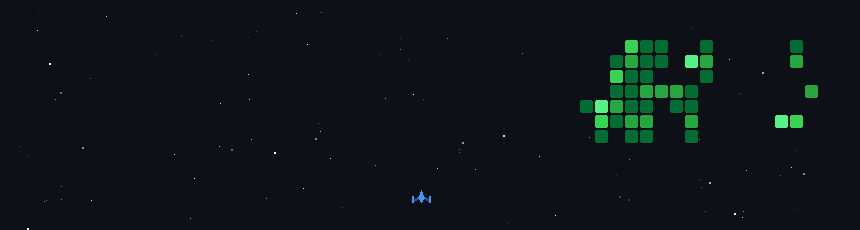

  

  <h1>lzak Gabriel</h1>

  

  
Learning, creating, and improving — Trying to do better.

  
  
  

## About me

Software Engineering student focused on software development, programming fundamentals, and practical problem-solving.

I build small applications and study projects to turn concepts into working software. My current work includes Python command-line applications, REST API development with FastAPI, relational data storage with SQLite, and algorithmic exercises.

I also have an interest in visual design and creative work, which informs how I approach interfaces and documentation.

## Current focus

- Strengthening Python and software design fundamentals.
- Practicing SQL, relational databases, and data persistence.
- Learning Java and Android development.
- Studying C and low-level programming fundamentals.
- Improving testing, documentation, and Git workflows.

## Technologies & tools

  
  
  
  
  
  
  

## Learning & practicing

  
  
  
  
  

## Selected projects

### [Support Ticket System](https://github.com/lzakLP/Support-Ticket-System)

A Python application that evolved from a terminal-based CRUD exercise into a REST API built with FastAPI and SQLite. Includes request validation, persistent storage, and automated tests.

### [Scientific Calculator](https://github.com/lzakLP/Scientific-Calculator)

A modular Python command-line calculator with ten mathematical operations, input validation, error handling, and session-based calculation history.

### [Personal Library for Android](https://github.com/lzakLP/Personal-Library-Android)

An Android application concept focused on organizing books, reading history, ratings, bookmarks, and notes. The repository currently contains project documentation; implementation is still in development.

### [Energy Consumption Monitor (C)](https://github.com/lzakLP/energy-consumption-monitor-C)

A university project repository documenting a statistical approach to identifying unusually high electricity readings. The C source files are not yet present in the repository.

## GitHub activity

  

## Contribution Playthrough

  

